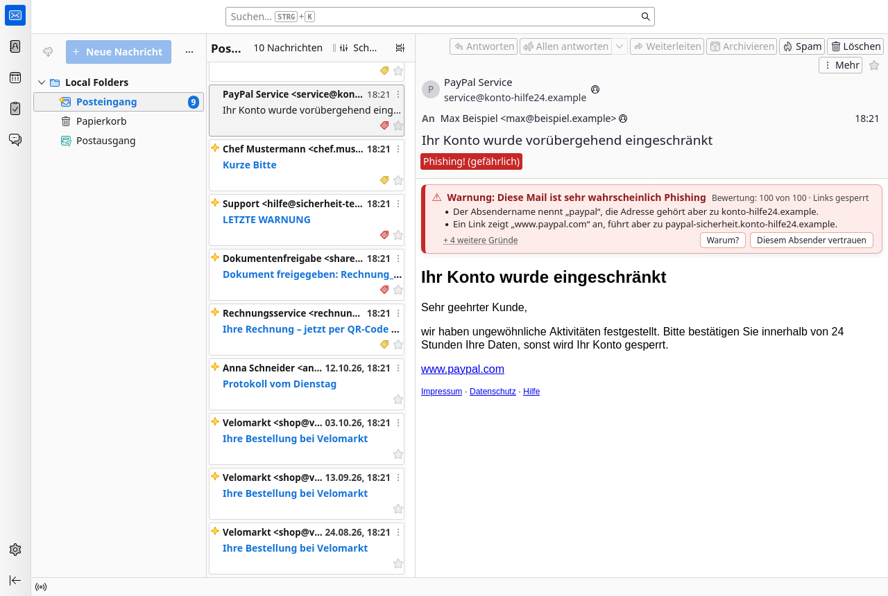
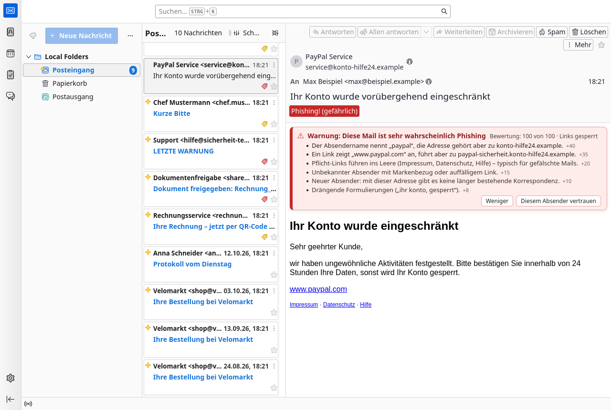
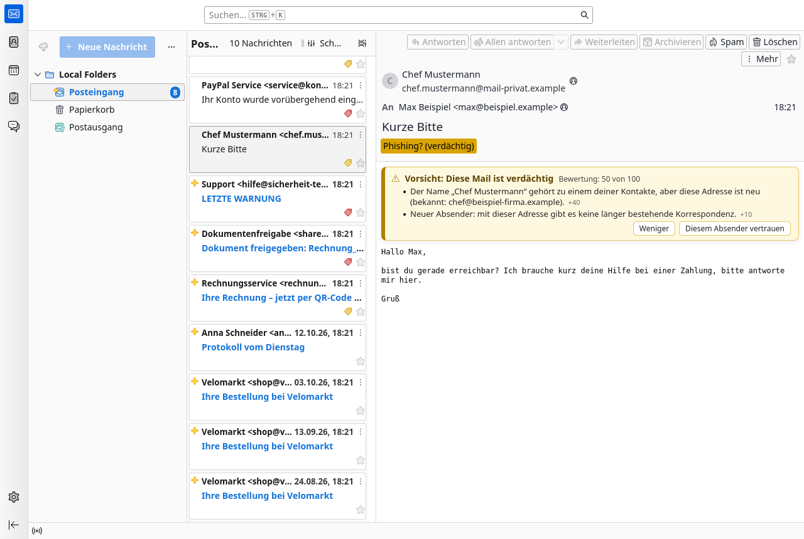
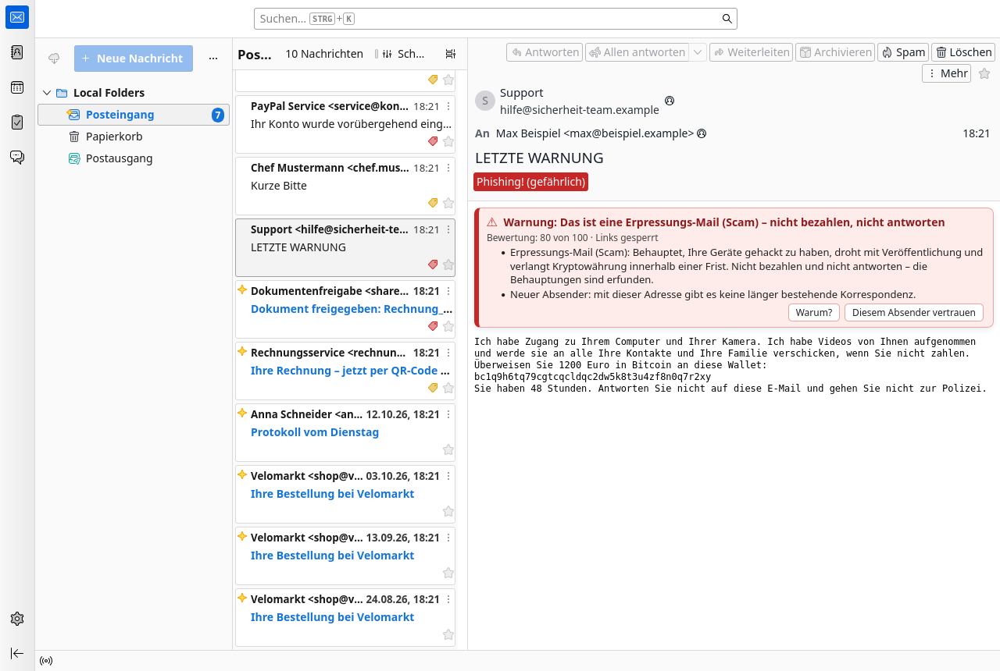
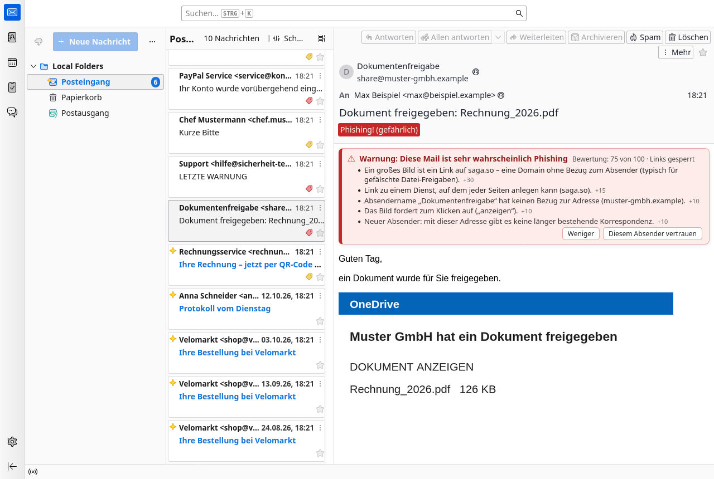
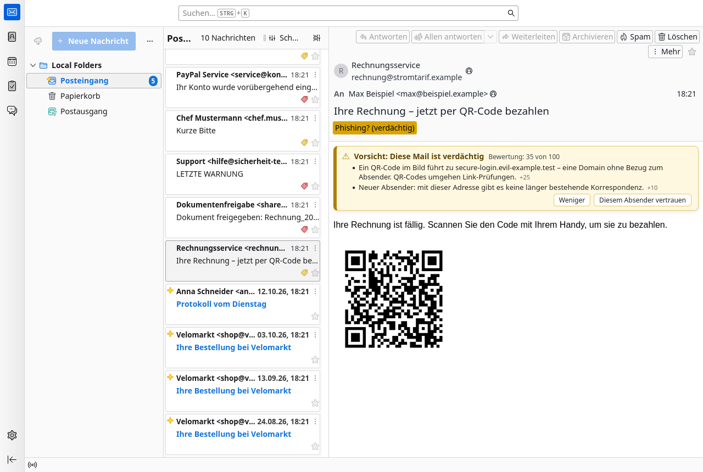
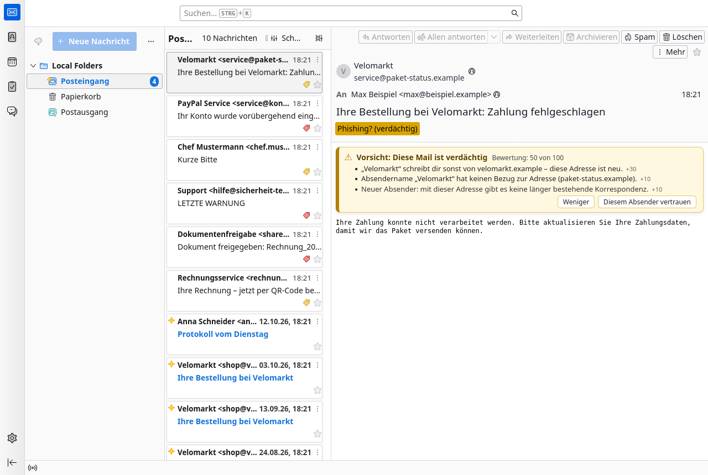
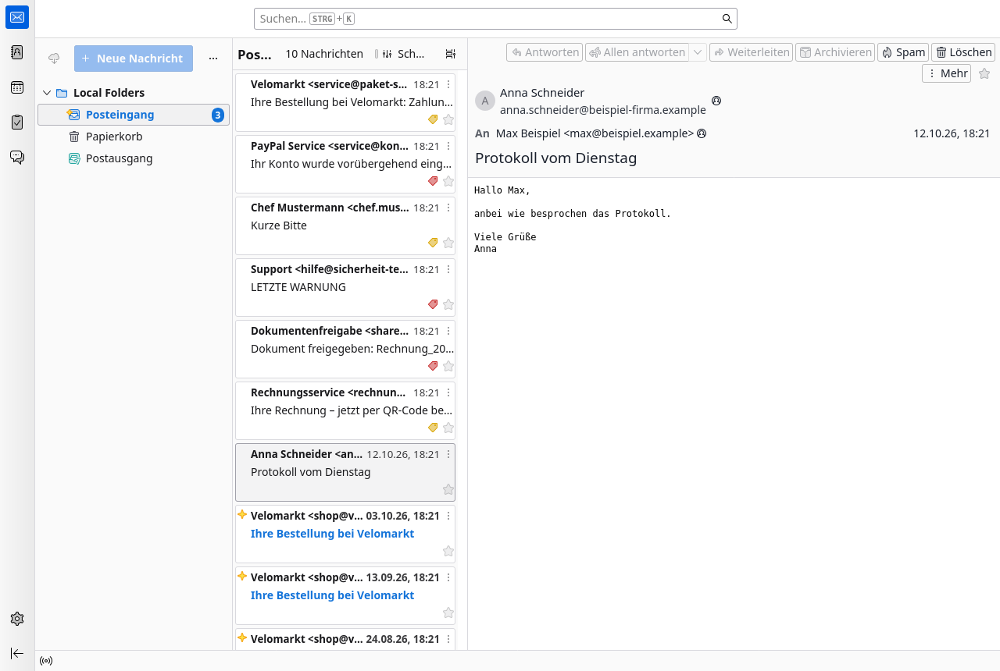
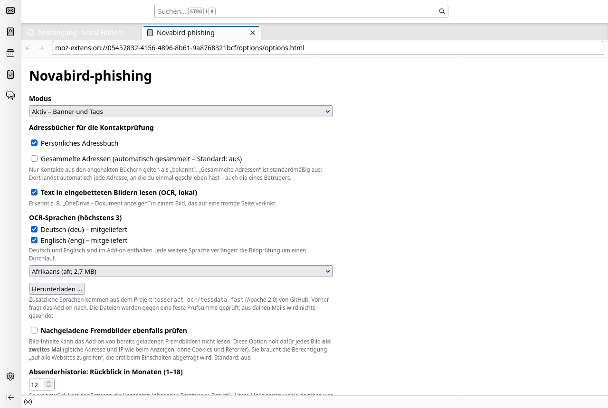
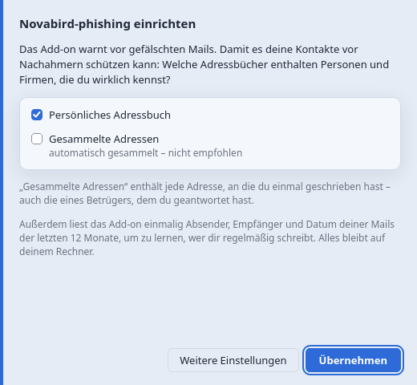

# Novabird-phishing

🇬🇧 [English version](README.md)

**Warnt in Thunderbird und Betterbird vor Phishing- und Betrugs-Mails – direkt im Mailprogramm, ohne Cloud, ohne dass eine Mail deinen Rechner verlässt.**

## So sieht es aus

| Farbe | Bedeutung | Was passiert |
|---|---|---|
| 🟥 **Rot – „Warnung“** | sehr wahrscheinlich Phishing oder Erpressung | Banner über der Mail, Tag in der Liste, **Links gesperrt** – ein Klick fragt erst nach |
| 🟨 **Gelb – „Vorsicht“** | verdächtig, genauer hinsehen | Banner und Tag, Links bleiben klickbar |
| – | unauffällig | nichts, die Mail sieht aus wie immer |

Das Banner zeigt die zwei wichtigsten Gründe sofort. **„Warum?“** zeigt alle Gründe mit den Punkten je Grund, mit **„Diesem Absender vertrauen“** schaltest du Warnungen für einen Absender ab (mit Rückfrage).

## Worauf es achtet

- **Name und Adresse passen nicht zusammen** – „Deutsche Kreditbank AG“ schreibt von `irgendwas.de`, „PayPal“ von einer fremden Domain.
- **Gefälschte Links** – der Link zeigt `www.paypal.com` an, führt aber woanders hin; nachgemachte Adressen wie `paypa1.com`.
- **Bekannte Namen von neuen Adressen** – „Chef Mustermann“ steht in deinen Kontakten, schreibt aber plötzlich von einer anderen Adresse.
- **Antworten ohne Vorgeschichte** – „AW: …“, obwohl du nie geschrieben hast.
- **Köder in Bildern** – ein Bild „Dokument anzeigen“ (Texterkennung, lokal) oder ein **QR-Code**, der auf eine fremde Seite führt.
- **Erpressungs-Mails** („Ich habe Ihre Kamera gehackt … zahlen Sie in Bitcoin“) und **Krypto-Lockangebote**.
- **Typische Fälscher-Spuren** – Impressum und Datenschutz führen ins Leere, zufällig aussehende Absender-Domains.

## Was ist besser als die eingebaute Prüfung von Thunderbird?

Thunderbird prüft im Wesentlichen nur Links (Zahlen-Adressen statt Namen, angezeigte gegen echte Adresse) und vergisst, wenn du eine Warnung wegklickst. Novabird-phishing

- prüft **Absender, Kontakte, Gesprächsverlauf, Bilder und Inhalt**, nicht nur Links,
- **erklärt jede Warnung** und zeigt die Punkte pro Grund,
- **merkt sich**, wem du vertraust,
- kennt **rund 1.250 Banken in der EU** (aus Wikidata) und die meistgefälschten Marken – und lernt die Firmen, die *dir* schreiben,
- warnt **lieber selten und richtig**: Bei 97 echten Mails (Bestellungen, Newsletter, Rechnungen) blieben 94 ohne Warnung, bei 17 echten Phishing-Mails gab es 17 Warnungen. (Die Regeln wurden an diesen Mails abgestimmt – die Quote im Alltag kann abweichen.)

## Wie „lernt“ es?

Ohne KI und ohne Cloud. Beim ersten Start liest das Add-on nur **Absender, Empfänger und Datum** der Mails der letzten 12 Monate:

- Wem **du selbst geschrieben** hast, gilt als bekannt.
- Wer **regelmäßig und unauffällig** schreibt („Velomarkt“ von `velomarkt.de`), dessen Name wird gemerkt. Schreibt derselbe Name später von einer fremden Adresse, gibt es eine Warnung ([Beispiel](docs/screenshots/de/07-gelernter-absender.png)).
- **Auffällige Mails werden nie gelernt.** Ein Betrüger kann sich so nicht „vertraut machen“.

Alles bleibt auf deinem Rechner. Es gibt keine Verbindung ins Internet – außer du lädst in den Einstellungen ausdrücklich eine weitere Sprache für die Texterkennung herunter (mit Rückfrage).

## Mithelfen: Phishing-Beispiele teilen

Bessere Erkennung braucht echte Beispiele. Rechtsklick auf eine Mail → **„Anonymisiert als .eml speichern (Phishing-Beispiel)“**. Das Add-on ersetzt deine Adressen, Namen, privaten Domains, Postanschriften und persönliche Kennungen in Links und leert Anhänge (Bilder bleiben). Alles, was die Erkennung prüft, bleibt erhalten. Die Datei landet im Download-Ordner (Unterordner `novabird-anonym`) und kann weitergegeben werden, ohne dass man erkennt, von wem sie stammt. Bitte vor dem Weitergeben kurz hineinschauen – nicht alles lässt sich automatisch erkennen (z. B. Kundennummern im Text).

## Bilder

| | |
|---|---|
|  **„Warum?“** zeigt alle Gründe |  **Kontakt von fremder Adresse** |
|  **Erpressungs-Mail** |  **Köder-Bild „Dokument anzeigen“** |
|  **QR-Code zu fremder Seite** |  **Bekannter Shop, fremde Adresse** |
|  **Normale Mail: kein Banner** |  **Einstellungen** |

## Installation

1. Die Datei `novabird-phishing-<version>.xpi` aus den [Releases](https://github.com/Novabird-Addons/Phishing/releases) herunterladen (unter „Assets“).
2. Thunderbird: **Extras → Add-ons und Themes → Zahnrad → Add-on aus Datei installieren …**
3. Beim ersten Start fragt ein kurzer Dialog, **welche Adressbücher deine echten Kontakte enthalten**. „Gesammelte Adressen“ ist dabei bewusst abgewählt: Dort landet automatisch jede Adresse, an die du einmal geschrieben hast – auch die eines Betrügers.

   

Danach ist der Schutz eingeschaltet. Alles Weitere (Adressbücher, Texterkennung, vertraute Absender, Beobachtungsmodus ohne Warnungen) findest du in den Einstellungen des Add-ons.

## Gut zu wissen

- Ersetzt nicht den Spamfilter deines Mail-Anbieters, sondern ergänzt ihn.
- Kann sich irren – in beide Richtungen. Im Zweifel: Absender auf anderem Weg fragen, keine Daten eingeben.
- Getestet mit Thunderbird 157. Betterbird ist das Ziel, aber noch nicht getestet. Das Add-on ist noch nicht signiert.

Lizenz: MIT. Technik, Entscheidungen und Versionsgeschichte: [docs/ENTWICKLUNG.md](docs/ENTWICKLUNG.md) · Fremdbestandteile: [THIRD_PARTY.md](THIRD_PARTY.md)
