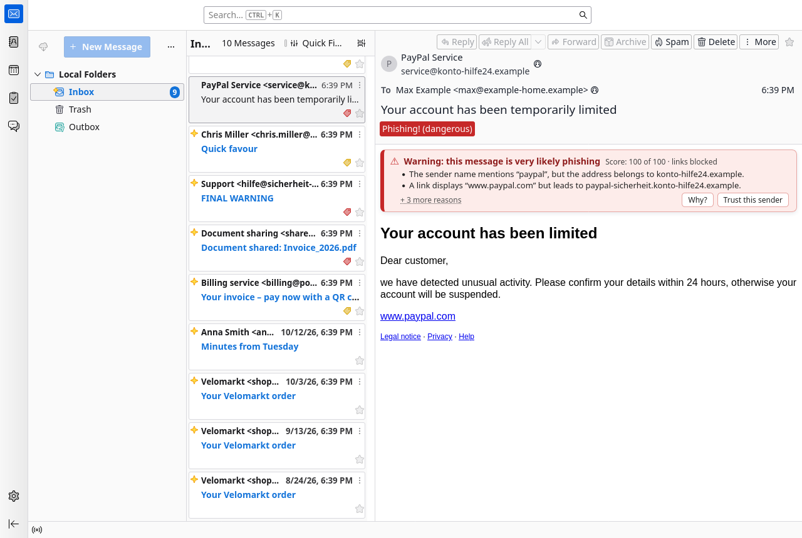
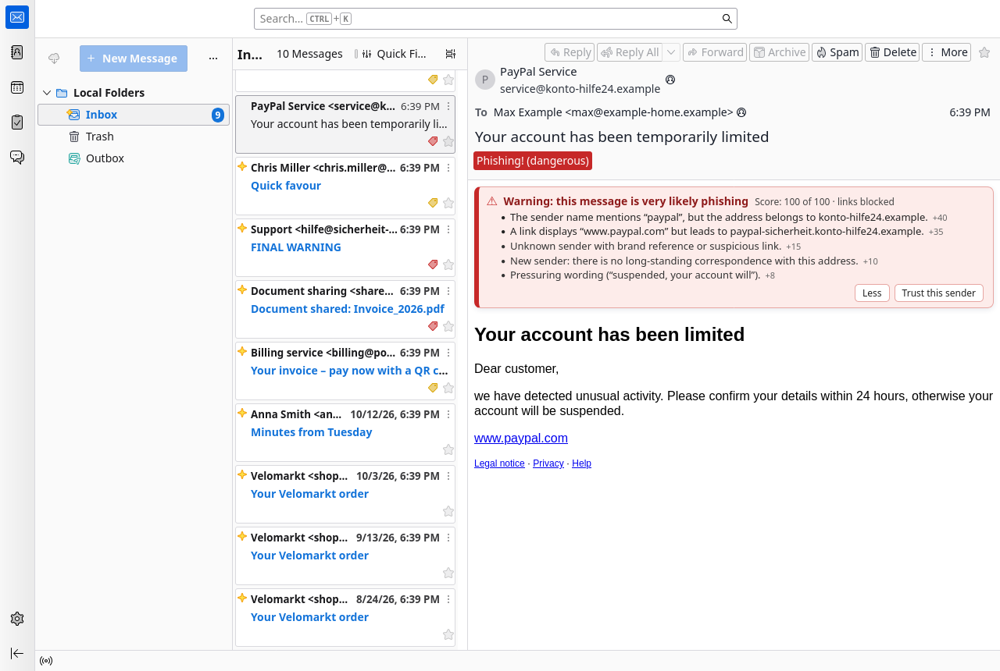
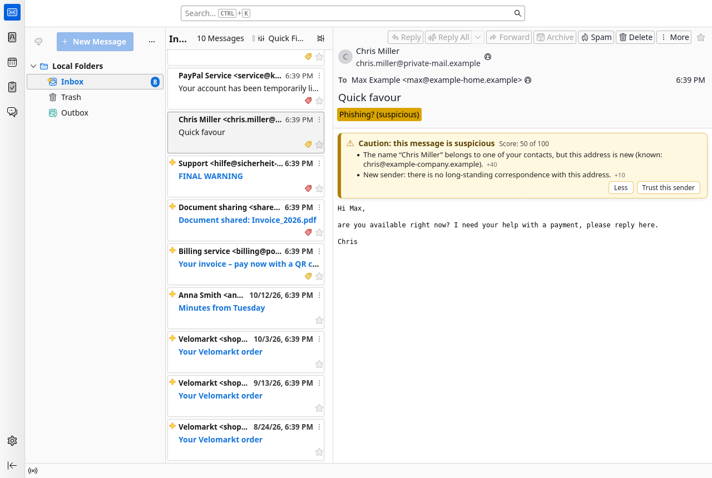
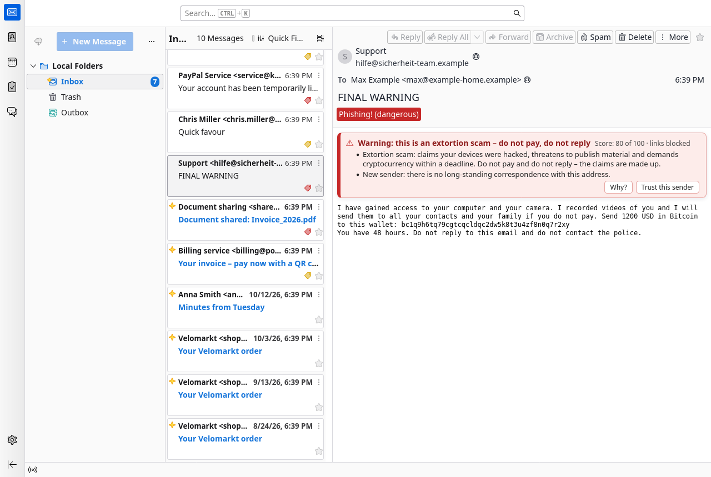
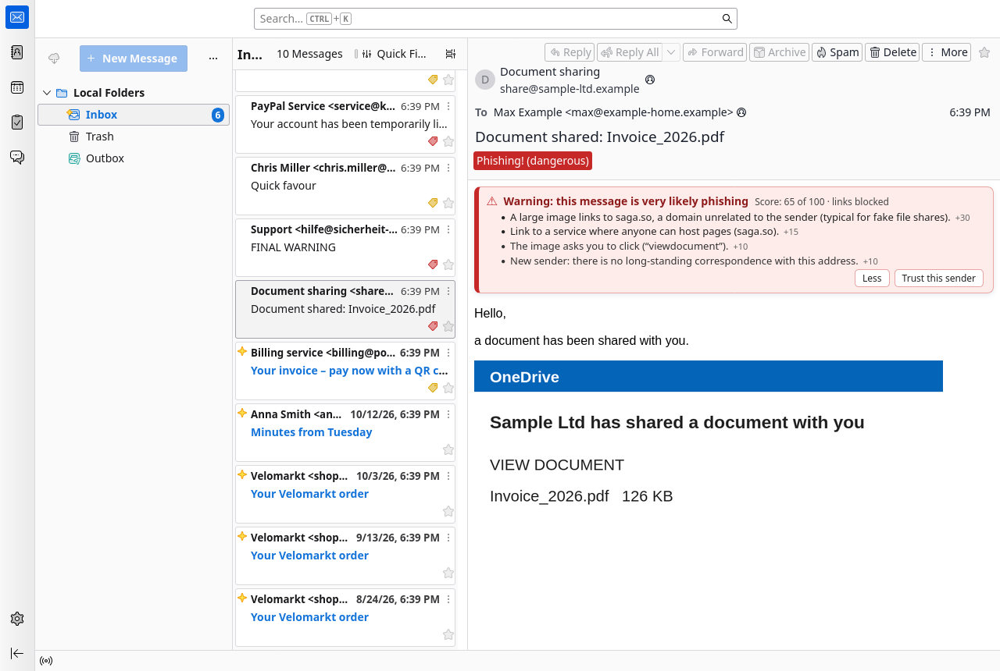
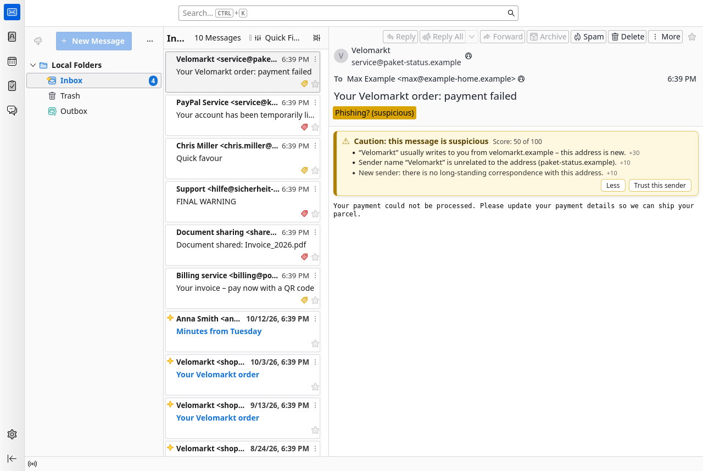
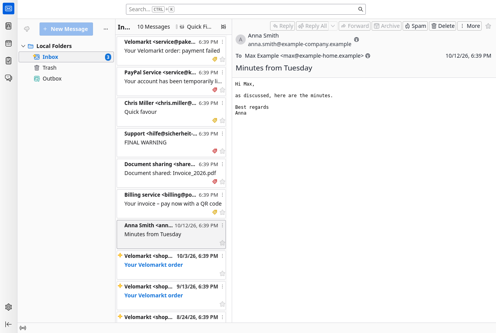
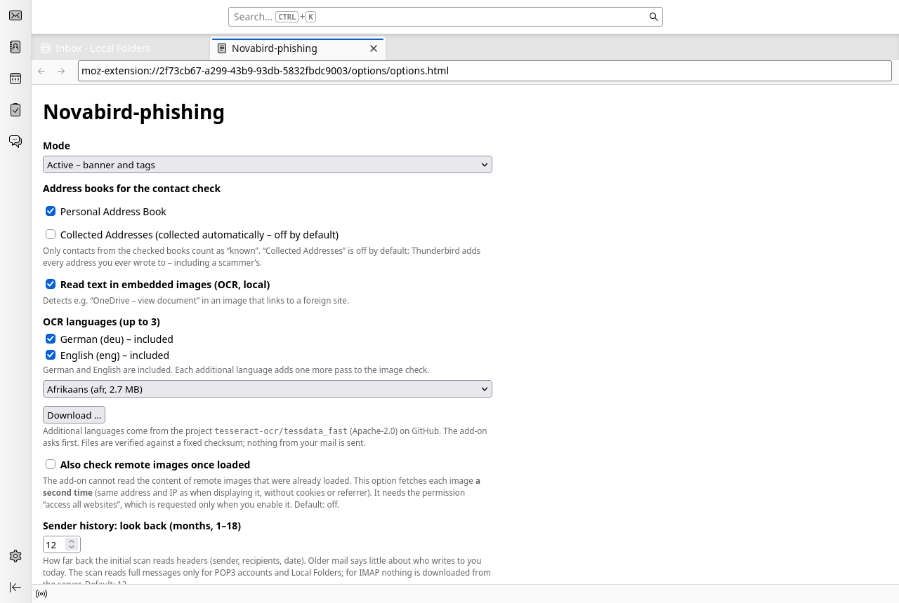
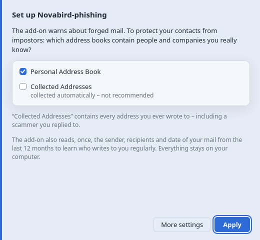

# Novabird-phishing

🇩🇪 [Deutsche Version](README.de.md)

**Warns you about phishing and scam emails in Thunderbird and Betterbird – right inside your mail client, without any cloud service, and without a single message leaving your computer.**

## What it looks like

| Colour | Meaning | What happens |
|---|---|---|
| 🟥 **Red – “Warning”** | very likely phishing or extortion | banner above the message, tag in the message list, **links are blocked** – a click asks first |
| 🟨 **Yellow – “Caution”** | suspicious, take a closer look | banner and tag, links stay clickable |
| – | inconspicuous | nothing, the message looks as usual |

The banner shows the two most important reasons right away. **“Why?”** lists all reasons with the points each one adds, and **“Trust this sender”** turns warnings off for one sender (after asking you to confirm).

## What it looks for

- **Name and address don’t match** – “Deutsche Kreditbank AG” writing from `something-else.com`, “PayPal” from a foreign domain.
- **Fake links** – the link *shows* `www.paypal.com` but leads somewhere else; look-alike addresses such as `paypa1.com`.
- **Known names from new addresses** – “Chris Miller” is in your contacts but suddenly writes from a different address.
- **Replies out of nowhere** – “Re: …” although you never wrote to them.
- **Bait in images** – a picture saying “View document” (text recognition, done locally) or a **QR code** pointing to a foreign site.
- **Extortion emails** (“I hacked your camera … pay in Bitcoin”) and **crypto investment lures**.
- **Dangerous attachments** – programs and scripts, also **inside ZIP files**; files that only pretend to be harmless (`invoice.pdf.exe`, a “PDF” that is really a program).
- **Typical forger traces** – legal notice and privacy links that lead nowhere, random-looking sender domains, domain endings popular with spammers (`.xyz`, `.top` … – only ever as an extra hint).

## What’s better than Thunderbird’s built-in check?

Thunderbird mainly checks links (numeric addresses instead of names, displayed vs. real address) and forgets when you dismiss a warning. Novabird-phishing

- checks **sender, contacts, conversation history, images and content**, not just links,
- **explains every warning** and shows the points per reason,
- **remembers** whom you trust,
- knows **about 1,250 banks across the EU** (from Wikidata) and the most frequently forged brands – and learns the companies that write to *you*,
- prefers to **warn rarely but correctly**: of 97 real messages (orders, newsletters, invoices) 94 got no warning, and all 17 real phishing messages got one. (The rules were tuned on these messages – results in everyday use may differ.)

## How does it “learn”?

No AI, no cloud. On first start the add-on reads only the **sender, recipients and date** of your messages from the last 12 months:

- Anyone **you have written to** counts as known.
- Senders who write **regularly and inconspicuously** (“Velomarkt” from `velomarkt.com`) have their name remembered. If the same name later writes from a foreign address, you get a warning ([example](docs/screenshots/07-learned-sender.png)).
- **Suspicious messages are never learned.** A scammer cannot make themselves “familiar” this way.

Everything stays on your computer. The add-on makes no internet connections – unless you explicitly download another language for text recognition in the settings (it asks first).

## Help improve it: share phishing samples

Better detection needs real examples. Right-click a message → **“Save anonymized as .eml (phishing sample)”**. The add-on replaces your addresses, names, private domains, postal addresses and personal identifiers in links, and empties attachments (images are kept). Everything the detection looks at stays intact. The file lands in your downloads folder (subfolder `novabird-anonym`) and can be shared without revealing who you are. Please take a quick look before sharing – the tool cannot catch everything (e.g. customer numbers in the text).

## Screenshots

| | |
|---|---|
|  **“Why?” shows every reason with its points** |  **Known contact, new address** |
|  **Extortion email** |  **Bait image “View document”** |
|  **QR code to a foreign site** |  **Familiar shop, foreign address** |
|  **Normal message: no banner** |  **Settings** |

## Installation

1. Download `novabird-phishing-<version>.xpi` from the [releases](https://github.com/Novabird-Addons/Phishing/releases) (under “Assets”).
2. In Thunderbird: **Tools → Add-ons and Themes → gear icon → Install Add-on From File …**
3. On first start a short dialog asks **which address books contain your real contacts**. “Collected Addresses” is deliberately unchecked: Thunderbird automatically adds every address you ever wrote to – including a scammer’s.

   

After that, protection is on. Everything else (address books, text recognition, trusted senders, an observation mode without warnings) is in the add-on’s settings.

## Good to know

- It complements your mail provider’s spam filter; it doesn’t replace it.
- It can be wrong – in both directions. When in doubt, ask the sender through another channel and don’t enter any data.
- The user interface is available in English and German.
- Tested with Thunderbird 157. Betterbird is the target but not yet tested. The add-on is not signed yet.

License: MIT. Technical details, decisions and version history (in German): [docs/ENTWICKLUNG.md](docs/ENTWICKLUNG.md) · Third-party components: [THIRD_PARTY.md](THIRD_PARTY.md)
